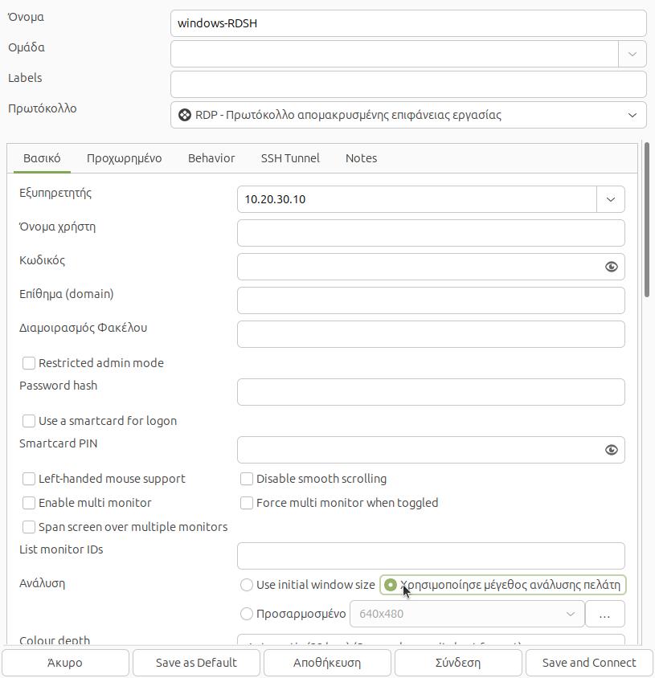

# Ρύθμιση σταθμού εργασίας

Ανάλογα το λειτουργικό σύστημα του σταθμού εργασίας που θα χρησιμοποιήσουμε για τη σύνδεση στον RDSH server διακρίνουμε τις περιπτώσεις:

## MS-Windows

- Από το μενού ***Έναρξη*** ▸ ***Όλα τα προγράμματα*** ▸ ***Βοηθήματα***, ανοίξτε την εφαρμογή `Σύνδεση Απομακρυσμένης Επιφάνειας Εργασίας` ή `Remote Desktop Connection` (εκτελέσιμο mstsc.exe).

- Εφόσον έχει ανοίξει το παράθυρο της εφαρμογής πληκτρολογείστε την IP διεύθυνση του εξυπηρετητή και επιλέξτε **`Σύνδεση`**.

- Κατόπιν πληκτρολογήστε το όνομα και τον κωδικό του χρήστη στον RDSH εξυπηρετητή.

## Ubuntu

Εάν οι σταθμοί εργασίας διαθέτουν λειτουργικό σύστημα Ubuntu μπορείτε να συνδεθείτε στον εξυπηρετητή RDSH χρησιμοποιώντας τις εφαρμογές:

- `Remina`

  [](remmina-create-connection.png)

  Η εφαρμογή Remmina, αν δεν είναι προ-εγκατεστημένη στο Ubuntu, εγκαταστήστε την με την εντολή:

  ```shell
  sudo apt install remmina
  ```

  και μπορείτε να τη βρείτε στο Gnome μενού  ***Μενού***  ▸  ***Διαδίκτυο*** με όνομα `Remmina`.

  Στο παράθυρο της εφαρμογής επιλέξτε **`+`** δώστε ένα όνομα στη σύνδεση και
  - πληκτρολογείστε την IP διεύθυνση του εξυπηρετητή
  - δώστε όνομα χρήστη και κωδικό
  - στην ανάλυση επιλέξτε ***Χρησιμοποιήστε μέγεθος ανάλυσης πελάτη***
  - και πατήστε το πλήκτρο **`Save and Connect`**.

- `Freerdp-X11`

  Η εφαρμογή xfreerpd3 μπορεί να εγκατασταθεί από τα αποθετήρια του ubuntu, με την εντολή:

  ```shell
  sudo apt install freerdp3-x11
  ```

  Για να συνδεθείτε σε έναν εξυπηρετητή ανοίξτε ένα τερματικό (πατώντας **`Alt`**+**`Ctrl`**+**`T`**) και δώστε την παρακάτω εντολή:

  ```shell
  xfreerdp3 /v:<IP διεύθυνση του εξυπηρετητή> /u:<username> /sound /gdi:sw /dynamic-resolution
  ```

!!! info "Πληροφορία"
    Για παλιότερες εκδόσεις ubuntu η εντολή είναι η `xfreerdp` και έχει λίγο διαφορετική σύνταξη:
    ```shell
    xfreerdp -f --plugin rdpsnd --gdi sw --no-nla <IP διεύθυνση του εξυπηρετητή>
    ```

!!! tip "Συμβουλή"
    Τα σύγχρονα λειτουργικά συστήματα υποστηρίζουν την τελευταία έκδοση του RDP πρωτοκόλλου. Αν έχετε παλιότερη έκδοση λειτουργικού συστήματος ελέγξτε στις [Απαιτήσεις](requirements.md) ποια έκδοση του RDP μπορεί να υποστηριχθεί και ποια χαρακτηριστικά επιτρέπονται. Σε πολύ παλιά λειτουργικά συστήματα (πχ XP) μπορεί να απαιτηθούν [επιπλέον ρυθμίσεις](advanced.md) στον RDSH εξυπηρετητή.
